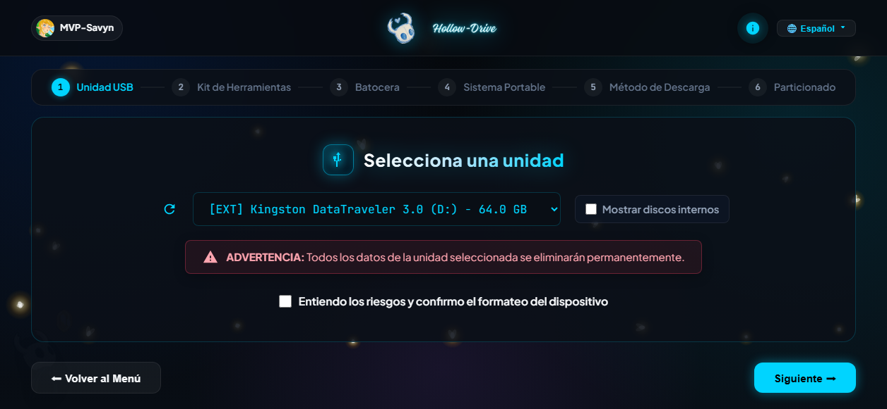
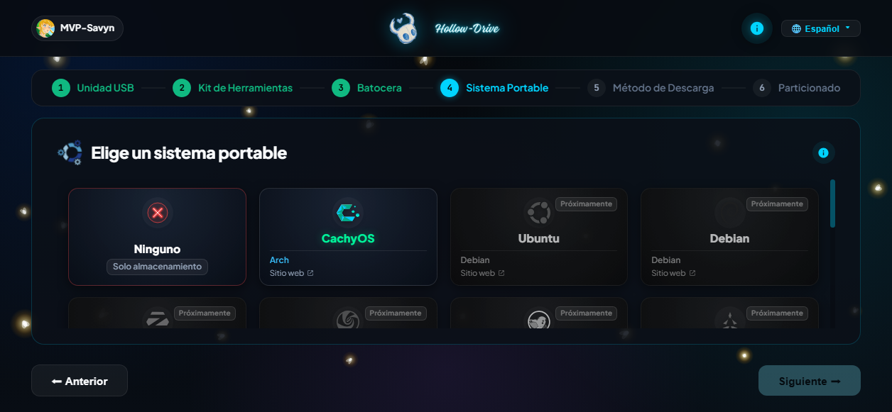
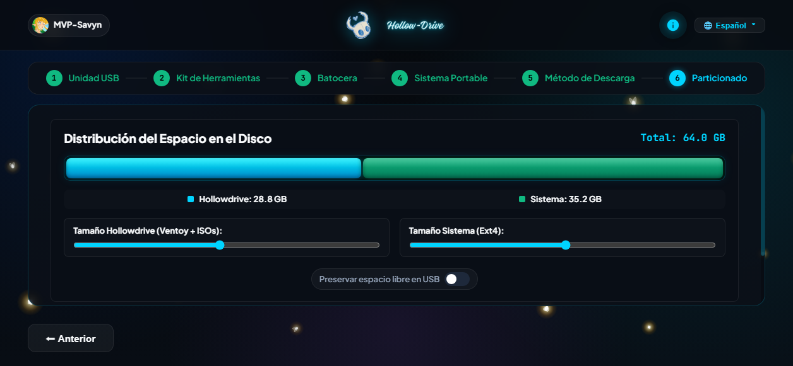

# HollowDrive

**El Santo Grial de los USB: Convierte cualquier pendrive en la suite técnica, de rescate y gaming más potente del mundo en pocos clics.**

[-0078d4?style=for-the-badge&logo=windows)](https://github.com/MVP-Savyn/SAVIN-HOLLOWDRIVE-public/releases)

 

<!-- BLOQUE DE VÍDEO TUTORIAL (YOUTUBE) -->

*Haz clic en la imagen superior para ver el tutorial oficial en YouTube.*

 

[Descargar Última Versión](#descargas-oficiales) &bull; [Capturas](#capturas-de-pantalla) &bull; [Batocera Portable](#batocera-retro-gaming-en-menos-de-5-gb) &bull; [Catálogo Web](#catálogo-web-de-addons) &bull; [Licencias y Créditos](#licencias-atribución-y-agradecimientos)

---

## Acerca de HollowDrive

HollowDrive es una suite todo-en-uno diseñada para preparar unidades USB multiboot de diagnóstico, rescate, instalación de sistemas y entretenimiento portátil sin configuraciones complejas.

A través de una interfaz interactiva y fluida con estética inspirada en Hollow Knight, el asistente te guía paso a paso en la detección del pendrive, el particionado inteligente, la integración de herramientas técnicas y la selección de sistemas operativos listos para arrancar en cualquier ordenador.

---

## Capturas de Pantalla

  <table>
    <tr>
      <td width="50%" align="center">
        <strong>Pantalla Inicial &bull; Hub de Bienvenida</strong>  
        
      </td>
      <td width="50%" align="center">
        <strong>Paso 1 &bull; Selección Segura de Unidad USB</strong>  
        
      </td>
    </tr>
    <tr>
      <td width="50%" align="center">
        <strong>Paso 4 &bull; Catálogo de Sistemas Portables</strong>  
        
      </td>
      <td width="50%" align="center">
        <strong>Paso 6 &bull; Distribución Dinámica del Disco</strong>  
        
      </td>
    </tr>
  </table>

---

## Características Principales

- **Instalación Asistida en 1 Clic**: Detección inteligente de unidades USB, formateo seguro y particionado óptimo (soporte dual para BIOS Legacy y UEFI, esquemas MBR y GPT).
- **Pack de Herramientas de Rescate Integrado**: Menú multiboot con antivirus offline, utilidades de clonación de discos, diagnóstico de memoria RAM y recuperadores de particiones.
- **Sistemas Portables Listos para Usar**: Distribuciones Linux optimizadas para arrancar en modo Live o persistente (CachyOS con kernel afinado, Ubuntu, Debian, Zorin OS, Arch, Fedora, Kali Linux y más).
- **Control Visual del Espacio**: Barras dinámicas y controles deslizantes interactivos para balancear con precisión los gigabytes asignados al sistema multiboot, los sistemas operativos y la partición de datos personales.
- **Validación Automática de Integridad**: Comprobación hash de archivos descargados para garantizar que los paquetes y sistemas se instalen libres de errores.

---

## 🎮 Batocera Retro Gaming en menos de 5 GB

Una de las funciones más potentes de HollowDrive es la integración nativa de **Batocera Linux** en tu pendrive:

- **Sin necesidad de instalarlo ni formatear todo el pendrive**: A diferencia del método tradicional que exige dedicar una memoria USB completa exclusivamente a Batocera, HollowDrive integra una imagen recortada y ultra-optimizada que ocupa **menos de 5 GB**.
- **Arranque en perfecto funcionamiento**: Permite arrancar directamente a la interfaz EmulationStation con sonido, mandos y aceleración gráfica activa, dejando el resto de la capacidad del pendrive para tus carpetas de ROMs, BIOS y herramientas técnicas.

---

## Descargas Oficiales

Para descargar el instalador oficial de HollowDrive para Windows:

&rarr; **[Ir a la sección de Releases oficiales](https://github.com/MVP-Savyn/SAVIN-HOLLOWDRIVE-public/releases)**

1. Entra en la versión más reciente con la etiqueta `Latest`.
2. En la lista de **Assets**, descarga `HollowDrive-Setup.exe`.
3. Ejecuta el instalador y sigue las instrucciones del asistente en pantalla.

---

## Catálogo Web de Addons

Puedes explorar el catálogo completo de paquetes, temas, fondos dinámicos y herramientas comunitarias desde la plataforma oficial:

&rarr; **[Visitar el Catálogo Oficial de HollowDrive](https://mvp-savyn.github.io/SAVIN-HOLLOWDRIVE-public/)**

> Si eres creador, puedes iniciar sesión con tu cuenta para publicar, gestionar y compartir tus propios packs de addons con el resto de la comunidad.

---

## Requisitos del Sistema

- **Sistema Operativo**: Windows 10 o Windows 11 (64-bit).
- **Permisos**: Privilegios de Administrador de Windows (indispensables para la gestión de bajo nivel y el particionado de unidades de almacenamiento).
- **Memoria USB**: Pendrive o disco externo de al menos 8 GB (recomendado 32 GB o superior para incluir sistemas portables y retrojuegos).
- **Conexión a Internet**: Necesaria para la descarga de addons, sistemas y actualizaciones de catálogo.

---

## Licencias, Atribución y Agradecimientos

HollowDrive es un proyecto desarrollado con un núcleo de software **propietario y de código cerrado**. Todas las interacciones con herramientas externas de código abierto se ejecutan de forma independiente bajo la cláusula legal de **Mera Agregación** (*Mere Aggregation*, GPLv3 Cláusula 5):

### Herramientas Core y Créditos Especiales

- **[MediCat USB](https://medicatusb.com/)** &bull; *Jayro Jones & MediCat Team*  
  Especial mención y agradecimiento a la comunidad y creadores de MediCat USB. La estructura y personalización de las opciones de menú y configuraciones de Ventoy en HollowDrive están inspiradas y basadas en su trabajo de optimización para memorias USB de rescate técnico.

- **[Ventoy](https://www.ventoy.net/)** &bull; *LongPang* (Licencia GNU GPLv3)  
  Binarios oficiales distribuidos de forma independiente en la carpeta `bin/ventoy/` para la creación de la estructura multiboot sin alteración de su código.

- **[7-Zip](https://www.7-zip.org/)** &bull; *Igor Pavlov* (Licencia GNU LGPL)  
  Motor binario externo distribuido en `bin/7z/` utilizado para la extracción y compresión eficiente de archivos y paquetes.

- **[Batocera Linux](https://batocera.org/)** (Licencia GNU GPLv2/v3)  
  Distribución retro-gaming especializada, arrancada mediante imagen optimizada independiente.

- **Distribuciones Portables Enlazadas**:  
  [CachyOS](https://cachyos.org) (GPL), [Ubuntu](https://ubuntu.com) (GPL), [Debian](https://www.debian.org) (GPL/DFSG), [Zorin OS](https://zorin.com) (GPL), [Arch Linux](https://archlinux.org), [Fedora](https://fedoraproject.org), [Linux Mint](https://linuxmint.com), [Kali Linux](https://www.kali.org), [Tails OS](https://tails.net) y [Pop!_OS](https://system76.com/pop).

### Bibliotecas de Software
- **Python Runtime**: Python Software Foundation License (PSFL).
- **Bottle**: MIT License.
- **PyWebView**: BSD 3-Clause License.
- **Requests & Urllib3**: Apache 2.0 / MIT.

*Todos los logotipos, nombres comerciales y marcas pertenecen a sus respectivos propietarios.*

---

## Comunidad y Soporte

- Si experimentas algún problema o tienes sugerencias de nuevas funciones, abre un ticket en la sección de **[GitHub Issues](https://github.com/MVP-Savyn/SAVIN-HOLLOWDRIVE-public/issues)**.
- Únete a nuestra comunidad para descubrir y crear nuevos packs de addons para HollowDrive.

---

Desarrollado con 💜 por **[MVP-Savyn](https://github.com/MVP-Savyn)**

